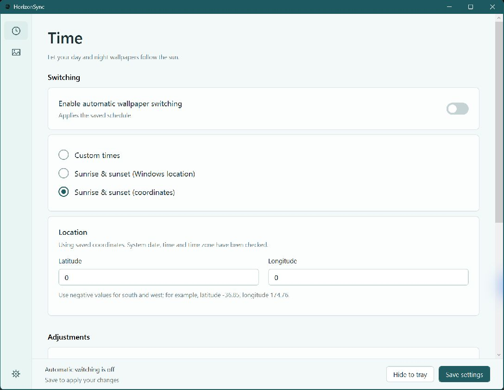

<div align="center">
  <picture>
    <source media="(prefers-color-scheme: dark)" srcset="assets/HorizonSync-White.svg">
    
  </picture>
</div>

<h1 align="center">HorizonSync</h1>
<p align="center">Let your wallpapers follow the sun.</p>

<div align="center">

[](https://github.com/fireery/HorizonSync-dev)
[](https://github.com/fireery/HorizonSync-dev/actions/workflows/ci.yml)
[](#requirements)
[](LICENSE)
[](https://github.com/fireery/HorizonSync-dev/pull/2)

</div>

<p align="center"><b>English</b> · <a href="README.zh-CN.md">简体中文</a></p>
<p align="center"><a href="https://github.com/fireery/HorizonSync-dev/releases">Download</a> · <a href="docs/USAGE.md">User guide</a> · <a href="https://github.com/fireery/HorizonSync-dev/issues">Feedback</a></p>

## Introduction

HorizonSync is a lightweight Windows companion for **Wallpaper Engine**. It switches between your day and night wallpapers using the local sunrise and sunset, so your schedule follows the seasons without periodic manual adjustments.

Solar events are calculated locally. HorizonSync runs independently and controls Wallpaper Engine through its documented command line interface.

## Features

- **Follow the sun:** use Windows location or enter coordinates, with separate sunrise and sunset offsets.
- **Follow Windows time:** use the current system date, time and time zone, including daylight saving changes.
- **Find Wallpaper Engine automatically:** reuse the saved installation location, show a clear readiness status, and link directly to the relevant setting if attention is needed.
- **Make it your own:** choose day and night wallpapers, or use custom fixed times.
- **Stay out of the way:** run in the tray, optionally start at sign-in, and realign after resume, unlock or an engine restart.
- **Choose your language:** English and Simplified Chinese, with a system-language option and instant switching.
- **Keep data local:** per-user settings, portable mode, recoverable configuration backups and no telemetry.

## Preview

<p align="center"></p>

*The screenshot uses example coordinates. The development branch adds thumbnail selection and centered GIF previews; the published preview package remains unchanged.*

## Download

Download an **installer** or **portable ZIP** from [GitHub Releases](https://github.com/fireery/HorizonSync-dev/releases). Release files include SHA-256 checksums and the corresponding source archive.

This first release is a **development preview**. Known validation gaps, including installer lifecycle and real wallpaper switching scenarios, are listed in [Validation status](docs/VALIDATION.md).

### Requirements

- Windows 10 Creators Update or later, or Windows 11.
- .NET Framework 4.8 or later.
- Wallpaper Engine installed and running as the same user with matching privileges.

The current version manages one Wallpaper Engine display index at a time. Solar events are estimates; terrain and atmospheric conditions affect the visible sunrise and sunset.

## Getting started

1. Open **Time**, choose a schedule and check the location. Preview today's plan.
2. Open **Wallpapers**, check the Wallpaper Engine status and choose your day and night wallpapers. Test each one.
3. Save your original Wallpaper Engine playlist and turn off its timed switching to avoid competing schedules.
4. Enable automatic switching, then select **Save settings**.

Closing the window keeps HorizonSync in the tray. Use **Quit HorizonSync** in the tray menu to stop it. See the [user guide](docs/USAGE.md) for configuration, recovery and uninstall instructions.

## Contributing

Bug reports, suggestions, code improvements and translations are welcome.

- [Report a problem or suggest a feature](https://github.com/fireery/HorizonSync-dev/issues/new).
- [Submit a pull request](https://github.com/fireery/HorizonSync-dev/compare).
- Check the [roadmap](docs/ROADMAP.md) before starting larger changes.

Build and test on Windows:

```powershell
.\build.ps1
.\tests\Run-Tests.ps1
```

Open `HorizonSync.csproj` in Visual Studio, or use the included compiler script. Application code depends only on system .NET Framework libraries. [Packaging and release checks](docs/RELEASE.md) cover portable and Inno Setup installer builds.

## License

HorizonSync is distributed under **[GNU GPL v3.0 only](LICENSE)** (`GPL-3.0-only`), without warranty. The corresponding source and build scripts are included in this repository.

Copyright © 2026 fireery and HorizonSync contributors.

## Acknowledgements

- [Wallpaper Engine](https://help.wallpaperengine.io/en/functionality/cli.html) for the documented control interface.
- [NOAA solar calculations](https://gml.noaa.gov/grad/solcalc/calcdetails.html) for the solar calculation reference.
- [HMCL](https://github.com/HMCL-dev/HMCL) for the README layout reference.

HorizonSync is an independent project and does not bundle Wallpaper Engine or Auto Dark Mode.
